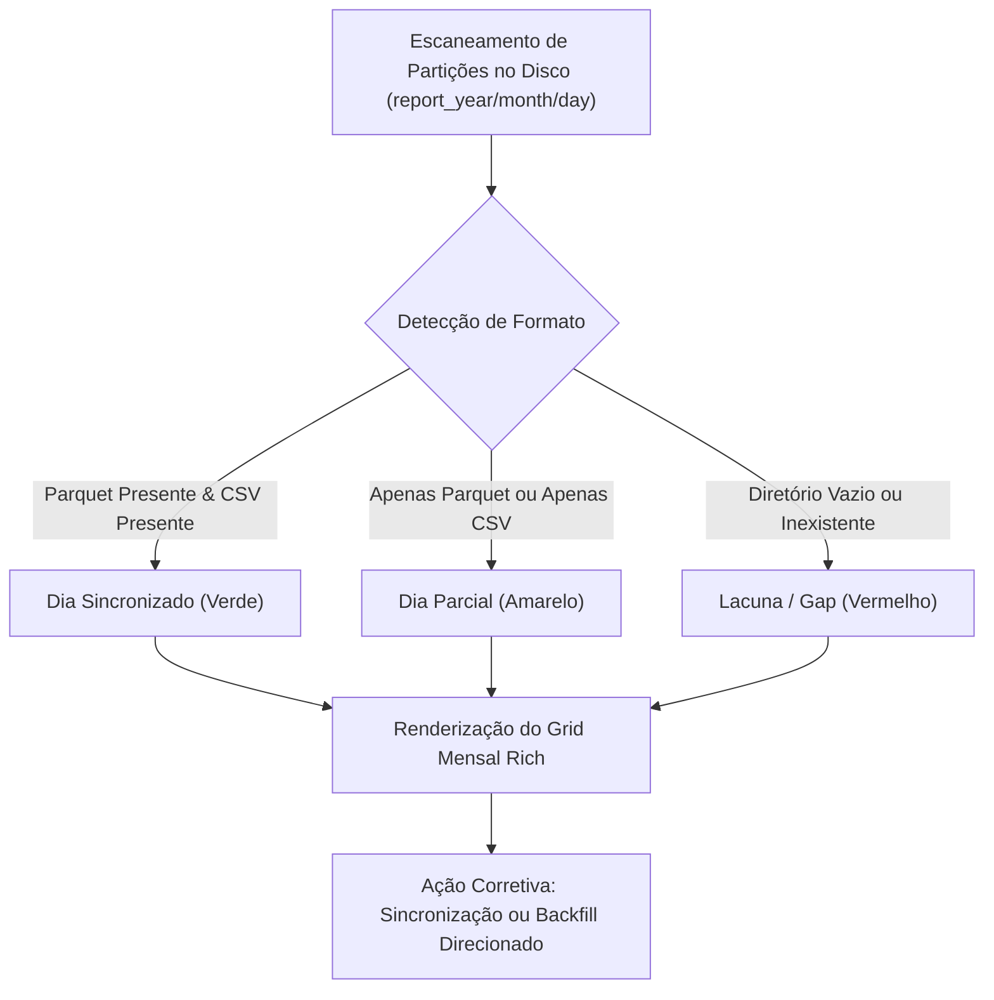
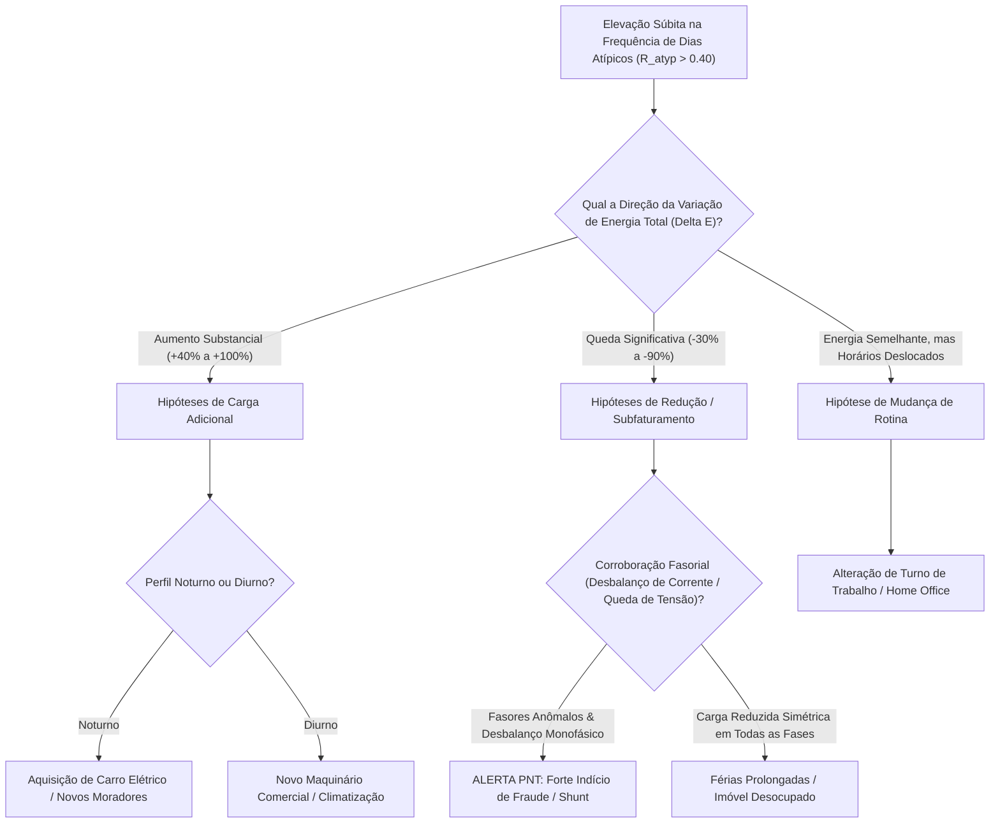

# Arquitetura de Aplicação, Engenharia de Dados Massivos (Polars/Sinking) e Análise Exploratória (EDA): Do Diagnóstico Temporal em TUI à Modelagem de Perfis Diários e Dias Atípicos

> **Classificação:** Artigo Técnico / Capítulo Metodológico e Experimental de Dissertação  
> **Área:** Engenharia Elétrica, Computação Aplicada, Ciência de Dados em Smart Grids  
> **Status:** Especificação Canônica de Sistema, Ingestão, EDA e Dinâmica Intradiária de Consumo  

---

## Resumo Executivo

A aplicação de modelos analíticos sobre dados de Infraestrutura de Medição Inteligente (AMI) em concessionárias de energia elétrica esbarra em três barreiras críticas:
1. **O gargalo de extração e volumetria:** A movimentação de milhões de registros diários de memória de massa e fasores instantâneos a partir de bancos relacionais corporativos (Oracle/CIS/MDM) satura a memória principal se processada de forma ingênua.
2. **A cegueira temporal e integridade de séries temporais:** Lacunas ocultas na telemetria, rotatividade de medidores (troca de NIO vinculada à mesma UC) e disparidades de cobertura invalidam o treinamento direto de modelos de aprendizado de máquina.
3. **A falta de contextualização topológica e comportamental intradiária:** Consumidores não operam isolados; estão subordinados à física de seus alimentadores e transformadores, e seu padrão de consumo obedece a assinaturas diárias (24 horas) cuja alternância entre dias típicos e atípicos carrega fortes indícios de fraudes, anomalias ou alterações cadastrais severas.

Este artigo apresenta a arquitetura holística da aplicação desenvolvida para o ecossistema Copel (Araucária), detalhando:
- A interface orientada a terminal (**TUI - Terminal User Interface**) baseada em componentes Rich, fornecendo governança interativa, auditoria visual de continuidade por calendário e controle granular de pipelines;
- O motor de extração resiliente com **Polars e Streaming/Sinking colunar**, garantindo idempotência estrita, checkpointing diário e geração de resultados parciais imediatos sem sobrecarga de memória;
- A análise exploratória de dados (**EDA**) evidenciando a relação entre Unidades Consumidoras (UC) e Números de Instalação de Operação (NIO) ao longo do tempo, bem como o impacto da agregação por alimentador;
- A modelagem de **perfis diários normalizados de 24 horas** e a detecção de **dias atípicos frequentes**, distinguindo variações sazonais esperadas de transições abruptas de regime de consumo (ex.: início de fraude, desvio de carga, entrada de novos ocupantes ou férias).

---

## 1. Arquitetura da Aplicação e a Interface TUI de Governança

### 1.1. Filosofia de Design: Por que uma TUI Rica?

A interface do sistema foi construída sob o paradigma de **TUI (Terminal User Interface)** utilizando a biblioteca `Rich`. Em ambientes de infraestrutura de concessionárias e servidores dedicados de extração, interfaces gráficas pesadas (GUIs) via navegador ou aplicações desktop são inviáveis devido à latência de rede, ausência de servidores X11 e restrições de segurança em túneis SSH.

A TUI desenvolvida encapsula toda a complexidade do pipeline em uma experiência visual intuitiva, modular e à prova de falhas:

```
┌────────────────────────────────────────────────────────────────────────┐
│               SISTEMA DE DETECÇÃO DE ANOMALIAS - ARAUCÁRIA             │
│                 ECOSSISTEMA DE EXTRAÇÃO & MACHINE LEARNING             │
├────────────────────────────────────────────────────────────────────────┤
│  [1] 🚀 Pipeline de Extração & Ingestão (Auto-Backfill, Período, Dia)  │
│  [2] 🧠 Treinamento e Seleção de Modelos (PRODIST, Composto, MoE)      │
│  [3] 📅 Governança de Dados, Calendário e Auditoria de Continuidade   │
│  [4] ⚖️ Comparação de Especialistas vs. Baseline Global                │
│  [5] 🩺 Diagnóstico de Saúde do Data Lake e Deteccão de Lacunas        │
│  [6] ⚙️ Configurações Operacionais & Formatos (Parquet / CSV)          │
│  [0] 🚪 Encerrar Sessão                                                │
└────────────────────────────────────────────────────────────────────────┘
```

### 1.2. Auditoria Temporal por Calendário e Rastreamento de Lacunas

Um dos módulos centrais da TUI é o **Calendário Mensal de Continuidade de Telemetria** (`src/visualization/continuity.py`). Em vez de executar queries cegas no data lake, o operador visualiza o estado de ingestão particionada:



O calendário exibe métricas essenciais por dia:
* Quantidade de medições instantâneas capturadas;
* Quantidade de curvas de carga de 15 minutos;
* Flag de integridade e divergência volumétrica entre alimentadores;
* Capacidade de disparar a conversão em lote de `.parquet` para `.csv` (ou vice-versa) em segundos, sem reconsultar os bancos de dados transacionais.

---

## 2. Ingestão Inteligente e Extração Massiva com Polars e Sinking Colunar

### 2.1. O Desafio da Volumetria AMI

A rede inteligente do município de Araucária conta com dezenas de milhares de medidores gerando leituras fasoriais instantâneas (tensão, corrente, fator de potência, distorção harmônica) e memória de massa a cada 15 minutos (96 pontos diários por grandeza). 

Uma abordagem tradicional utilizando DataFrames convencionais em Pandas provoca estouro de memória (*Out-Of-Memory - OOM*) e degradação severa no garbage collector. Além disso, falhas pontuais de conexão derrubariam horas de extração ininterrupta.

### 2.2. A Solução: Particionamento, Polars Streaming e Sinking

O motor de extração implementado em [`scripts/run_araucaria_full.py`](file:///d:/Projects/tcc_extraction/scripts/run_araucaria_full.py) e [`src/pipeline.py`](file:///d:/Projects/tcc_extraction/src/pipeline.py) foi estruturado sob os princípios:

1. **Idempotência Estrita e Auto-Backfill:**
   A função `find_datalake_date_coverage()` inspeciona as partições físicas salvas. Ao acionar o modo inteligente, o pipeline detecta a data mais recente consolidada com sucesso (ex.: $T$) e inicia a busca a partir de $T+1$ até o dia anterior ao corrente ($D-1$), preenchendo automaticamente eventuais lacunas no histórico.
2. **Chunking Otimizado no Oracle:**
   A consulta aos medidores no banco corporativo é realizada através de tipos nativos `SYS.ODCIVARCHAR2LIST`, dividindo a população de identificadores em lotes controlados (ex.: 200 a 500 identificadores por consulta).
3. **Escrita Direta em Streaming (Sinking):**
   Utilizando o Polars, os fluxos de dados retornados do driver de banco de dados são vertidos diretamente em batches colunares. Ao invés de concatenar matrizes gigantescas na RAM:
   - Os tipos de dados são rigorosamente castados na borda;
   - Aplica-se `pl.LazyFrame` com pipeline de transformações otimizado;
   - Os dados são despejados no disco via `sink_parquet()` particionado por `report_year=YYYY/report_month=MM/report_day=DD`.
4. **Resultados Parciais Disponíveis Imediatamente:**
   Se uma rotina de 30 dias for interrompida no 14º dia (`Ctrl+C` ou queda de rede), os primeiros 13 dias permanecem íntegros, fechados e imediatamente utilizáveis pelos modelos analíticos.

---

## 3. Análise Exploratória de Dados (EDA): Dinâmica Topológica e Cadastral

### 3.1. A Relação Fundamental: Unidade Consumidora (UC) vs. Identificador de Operação (NIO)

Um erro primário em modelos de perdas não técnicas é modelar a série temporal indexada cegamente pelo medidor (NIO - Número de Instalação de Operação) ou pela UC sem considerar sua dinâmica de acoplamento:

$$\text{UC} \xrightarrow{1 : N(t)} \text{NIO}(t)$$

```
Linha do Tempo de uma Unidade Consumidora (UC)
├── [2025-01 a 2025-08]: Medidor Antigo (NIO #101) ──> Subfaturamento / Queda gradual
├── [2025-08-15]: Ordem de Serviço de Campo ──> Troca de Medidor
└── [2025-08-16 em diante]: Medidor Inteligente Novo (NIO #205) ──> Salto no consumo registrado
```

* **UC (Unidade Consumidora):** Representa o ponto de entrega fixo da instalação física, o vínculo contratual e cadastral com a distribuidora.
* **NIO (Identificador do Ponto/Medidor):** Representa o hardware físico instalado no local.

**Implicações Analíticas da EDA:**
- Uma quebra abrupta na curva de carga indexada por UC frequentemente decorre da substituição de um medidor avariado por um medidor novo (mudança de NIO).
- Tratar essa descontinuidade como anomalia de consumo gera falsos positivos em massa.
- O pipeline rastreia o histórico do NIO: sempre que há um evento de transição cadastral de medidor na mesma UC, a janela de detecção de mudança de regime (*Change Point Detection*) é contextualizada, evitando que a regularização física do hardware seja contabilizada como fraude.

### 3.2. Distribuição Topológica por Alimentadores e Consenso de Barramento

A análise exploratória demonstra que o comportamento do consumo e das grandezas fasoriais não é homogêneo na rede de distribuição:
1. **Alimentadores Rurais vs. Urbanos:** Alimentadores predominantemente rurais apresentam perfis de carga com ciclos de bombeamento, ordenha mecânica ou irrigação, com grande dispersão de tensão ao longo do comprimento dos condutores (quedas de tensão resistivas/reativas nas pontas de linha).
2. **Alimentadores Industriais/Comerciais:** Curvas retangulares concentradas em horário comercial, com consumo nulo ou estritamente residual em finais de semana.
3. **Consenso Espacial de Transformador:**
   Se 80% das UCs conectadas ao mesmo transformador de distribuição (MT/BT) apresentam queda simultânea de tensão ou desbalanceamento em uma determinada terça-feira, o evento é invariavelmente **sistêmico** (queima de transformador, manobra de rede, subtensão da subestação). Se apenas uma UC exibe distorção fasorial e queda de impedância enquanto as demais permanecem dentro dos parâmetros normativos do PRODIST Módulo 8, o modelo isola a anomalia na instalação individual.

---

## 4. Modelagem de Perfis Diários (24h) e Detecção de Dias Atípicos Frequentes

### 4.1. Construção da Assinatura Intradiária Normalizada

Para categorizar os padrões de comportamento do consumidor sem sofrer o viés do consumo absoluto (uma residência unifamiliar consome 150 kWh/mês enquanto um comércio consome 2.500 kWh/mês), a série temporal de potência ativa e reativa de cada dia $d$ é discretizada em 96 intervalos de 15 minutos:

$$\mathbf{x}_i(d) = [p_{i, 0}(d), p_{i, 1}(d), \dots, p_{i, 95}(d)]^T$$

Aplica-se a **normalização min-max intradiária** ou **padronização em norma unitária**:

$$\tilde{\mathbf{x}}_i(d) = \frac{\mathbf{x}_i(d) - \min(\mathbf{x}_i(d))}{\max(\mathbf{x}_i(d)) - \min(\mathbf{x}_i(d)) + \epsilon}$$

Essa transformação preserva a **morfologia geométrica da curva de carga**:
- Picos matutinos e noturnos residenciais;
- Platôs contínuos industriais;
- Curvas com geração distribuída solar fotovoltaica (efeito curva da banheira invertida / "curva do pato").


### 4.2. Matriz de Perfis Base e Dinâmica de Transição

Através de algoritmos de aprendizado não supervisionado (K-Means sobre coeficientes de decomposição por componentes principais - PCA), define-se um dicionário de $K$ perfis prototípicos de 24 horas:

$$\mathcal{C} = \{\mathbf{c}_1, \mathbf{c}_2, \dots, \mathbf{c}_K\}$$

A cada dia $d$, a unidade consumidora $i$ é atribuída ao perfil mais próximo:

$$k_i(d) = \arg\min_{k} \|\tilde{\mathbf{x}}_i(d) - \mathbf{c}_k\|_2$$

Define-se a **distância ao perfil canônico** como o escore de atipicidade diária:

$$\delta_i(d) = \|\tilde{\mathbf{x}}_i(d) - \mathbf{c}_{k_i(d)}\|_2$$

Um dia é rotulado como **Atípico** se $\delta_i(d) > \tau_{\text{atyp}}$ ou se o perfil $k_i(d)$ diverge substancialmente dos perfis modais históricos daquela UC para aquele dia da semana.

---

## 5. A Lógica dos "Dias Atípicos Frequentes": Sazonalidade vs. Mudança Estrutural

O cerne da detecção comportamental reside em como a frequência e a regularidade dos dias atípicos se distribuem ao longo do tempo.

### 5.1. Dias Atípicos Sazonais e Esperados

Considere um consumidor residencial que trabalha remotamente de segunda a sexta-feira, mas realiza viagens regulares nos finais de semana, ou um comércio fechado aos domingos:

```
Consumidor A: Padrão Estável com Atipicidade Semanal Recorrente
Seg   Ter   Qua   Qui   Sex   Sáb   Dom   Seg   Ter   Qua   Qui   Sex   Sáb   Dom
 ●     ●     ●     ●     ●     ▲     ▲     ●     ●     ●     ●     ●     ▲     ▲
Legenda: ● = Perfil Típico Residencial | ▲ = Perfil Atípico (Consumo Mínimo / Viagem)
```

Nesse cenário:
* A atipicidade ocorre com periodicidade determinística (período de 7 dias);
* A distribuição de probabilidade condicional $P(\text{Atípico} \mid \text{Dia da Semana} \in \{\text{Sáb}, \text{Dom}\}) \approx 1.0$;
* **Diagnóstico do Modelo:** Comportamento perfeitamente compatível com rotina saudável. Nenhum alerta é gerado.

### 5.2. A Transição para "Dias Atípicos Frequentes": Mudanças de Vida vs. Anomalias

O alerta comportamental é disparado quando a **taxa basal de dias atípicos sofre uma ruptura estrutural**:

```
Consumidor B: Ruptura Estrutural com Aumento Drástico de Atipicidades
Semana 1:  ●  ●  ●  ●  ●  ▲  ▲   (2/7 dias atípicos - Baseline Normal)
Semana 2:  ●  ●  ●  ●  ●  ▲  ▲   (2/7 dias atípicos - Baseline Normal)
[EVENTO: Alteração no Domicílio ou Instalação de Desvio Parcial]
Semana 3:  ●  ▲  ▲  ●  ▲  ▲  ▲   (5/7 dias atípicos - Alerta Amarelo)
Semana 4:  ▲  ▲  ▲  ▲  ▲  ▲  ▲   (7/7 dias atípicos - Alerta Vermelho: Mudança de Regime)
```

Para modelar essa dinâmica, calcula-se a taxa móvel de dias atípicos em uma janela de $W$ dias (ex.: $W = 28$ dias):

$$R_{\text{atyp}}(t) = \frac{1}{W} \sum_{d=t-W+1}^{t} \mathbb{I}(\text{Dia } d \text{ é atípico})$$

E a variação de entropia na distribuição semanal de perfis:

$$H_i(t) = - \sum_{k=1}^{K} p_i(k; t) \log_2 p_i(k; t)$$

### 5.3. Árvore de Decisão e Desambiguação de Hipóteses

Quando $R_{\text{atyp}}(t)$ supera o limiar operacional, o sistema avalia atributos correlacionados para desambiguar a causa:



Essa triagem automatizada transforma uma simples "anomalia estatística de caixa-preta" em uma **evidência contextualizada e compreensível para o fiscal de campo**.

---

## 6. Síntese da Metodologia e Impacto na Operação

A integração entre infraestrutura de dados resiliente, governança em terminal e modelagem diária fecha o elo entre o dado bruto de telemetria e o retorno operacional:

1. **A TUI e o Calendário de Continuidade** asseguram que nenhum modelo seja treinado sobre lacunas silenciosas ou conjuntos incompletos.
2. **A Ingestão com Polars e Sinking** viabiliza o processamento de horizontes temporais extensos de milhares de alimentadores em hardware convencional de baixo custo.
3. **A Relação UC-NIO** protege o sistema contra alarmes falsos originados por manutenções programadas e trocas legítimas de medidores.
4. **O Modelo de Perfis de 24h e Dias Atípicos Frequentes** isola sutilezas morfológicas da curva de carga, permitindo diferenciar um desvio fraudulento de consumo de hábitos sazonais ou flutuações cotidianas de vida dos consumidores.

Esta arquitetura fornece o arcabouço técnico necessário para alimentar o funil analítico de especialistas e garantir que a carteira de fiscalização selecionada atinja os ganhos econômicos e de acurácia estabelecidos.
