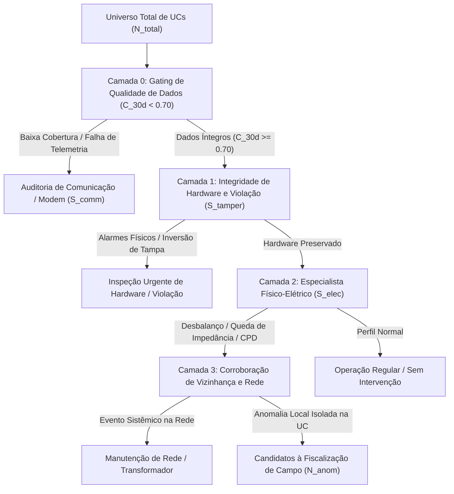
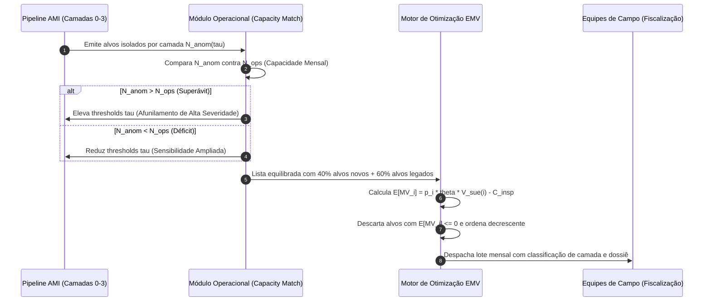

# Da Triagem em Camadas ao Valor Monetário Esperado: Alocação Ótima de Inspeções de Perdas Não Técnicas Sob Restrições Operacionais

> **Classificação:** Artigo Técnico / Capítulo Metodológico de Dissertação (TCC / Concessionária de Distribuição)  
> **Área:** Engenharia Elétrica, Ciência de Dados Aplicada, Pesquisa Operacional e Gestão de Perdas Não Técnicas (PNT)  
> **Status:** Proposta de Artigo Técnico / Modelagem Econômico-Operacional  

---

## Resumo Executivo

A identificação de Perdas Não Técnicas (PNT) em redes de distribuição de energia com infraestrutura de medição inteligente (AMI) frequentemente colapsa na interface entre o modelo analítico e a operação de campo. Modelos preditivos tendem a gerar volumes de alertas que superam em ordens de magnitude a capacidade mensal de inspeção das equipes de fiscalização, ou, inversamente, falham em fornecer granularidade suficiente para embasar ações fiscais e processos administrativos/judiciais (Termo de Ocorrência e Inspeção - TOI e cobranças retroativas).

Este artigo formaliza uma metodologia em três pilares fundamentais:
1. **Estatísticas de Isolamento em Camadas (Funil Analítico):** Quantificação do poder de corte e especialização de cada camada do modelo (telemetria/comunicação, integridade de hardware/tamper, física elétrica e corroboração espacial por transformador de distribuição).
2. **Casamento Operacional e Política de Alocação Incremental:** Ajuste dinâmico de limiares (*thresholds*) conforme a capacidade mensal de fiscalização da concessionária ($N_{\text{ops}}$), com diretriz de substituição de $40\%$ da carteira tradicional de fiscalização e meta de elevação de acurácia global em $+5$ pontos percentuais.
3. **Avaliação Financeira por Valor Monetário Esperado (EMV) e Penalização de Falsos Positivos:** Modelo microeconômico que contabiliza o ganho a partir do valor pleiteado em processo administrativo/judicial (cobrança retroativa) ponderado pela taxa de êxito, deduzido estritamente do custo logístico e operacional de inspeções infrutíferas (falsos positivos).

---

## 1. Introdução e Contexto Operacional

As distribuidoras de energia elétrica operam sob severas restrições orçamentárias e logísticas. Cada inspeção em campo envolve equipes especializadas, deslocamento veicular, equipamentos de calibração aferidos e riscos inerentes à segurança do trabalho em campo. Historicamente, as listas de fiscalização baseiam-se em regras empíricas de faturamento, variações sazonais de consumo médio ou denúncias.

Com o advento dos medidores inteligentes (AMI) e da modelagem multivariada em múltiplas visões, a taxa de detecção potencial aumenta expressivamente. Contudo, surge um dilema gerencial:

$$\text{Demandas de Inspeção Identificadas } (N_{\text{anom}}) \quad \lessgtr \quad \text{Capacidade Mensal Efetiva de Campo } (N_{\text{ops}})$$

Se o modelo opera de forma desacoplada da operação:
* **Quando $N_{\text{anom}} \gg N_{\text{ops}}$:** A operação sofre paralisia decisória (*alert fatigue*). Sem um ranqueamento rigoroso e estatísticas de corte por camada, os fiscais selecionam alvos aleatoriamente ou continuam utilizando critérios legados.
* **Quando $N_{\text{anom}} \ll N_{\text{ops}}$:** As equipes ficam ociosas ou realizam rondas aleatórias de baixo retorno financeiro, indicando que o modelo foi excessivamente conservador e deixou de capturar anomalias recuperáveis.

Portanto, o produto analítico deve **ser sustentado pela operação**. O objetivo deste trabalho é estabelecer a esteira de isolamento por camadas, o mecanismo de balanceamento capacidade/demanda e a função de utilidade financeira do modelo.

---

## 2. Isolamento de Unidades Consumidoras por Camadas Especialistas

A arquitetura do pipeline desmembra o espaço de anomalias em camadas ortogonais, evitando atribuir a uma única pontuação opaca naturezas de defeitos completamente distintas.

### 2.1. O Funil Analítico de Especialistas

A cada ciclo de faturamento ou lote mensal de telemetria, o universo total de $N_{\text{total}}$ Unidades Consumidoras (UCs) atravessa os seguintes filtros:



### 2.2. Estatísticas de Separação e Redução

Para cada camada $k \in \{0, 1, 2, 3\}$, definimos:
- **População de Entrada ($P_k$):** Total de UCs elegíveis submetidas à camada.
- **Volume Isolado ($I_k$):** Quantidade de UCs com evidência conclusiva naquela dimensão específica.
- **Taxa de Separação / Redução ($\rho_k$):**
  $$\rho_k = \frac{I_k}{P_k}$$

Essa segregação fornece um **plano de ação setorial**:
1. **$I_{\text{comm}}$ (Problema de Comunicação):** Não consome equipe de fiscalização de furto; gera ordem de serviço (OS) de telecomunicações/modem.
2. **$I_{\text{tamper}}$ (Hardware/Inversão):** Prioridade máxima para verificação de lacre e integridade mecânica.
3. **$I_{\text{elec}} \cap \text{Isolado}$ (Anomalia Específica da UC):** Casos com desbalanceamento severo de corrente, queda anômala de consumo ou salto de ângulo fasorial não acompanhado pelos vizinhos do mesmo transformador (MT/BT).
4. **$I_{\text{elec}} \cap \text{Sistêmico}$ (Distúrbio na Rede):** Direcionado para engenharia de manutenção de alimentadores/transformadores (PRODIST Módulo 8).

---

## 3. Gestão Incremental da Capacidade Operacional

### 3.1. Relação Capacidade vs. Demanda

A capacidade mensal de fiscalização da concessionária é denotada por $N_{\text{ops}}$ inspeções. O volume de anomalias elétricas isoladas pelo modelo é $N_{\text{anom}}(\tau)$, onde $\tau$ é o vetor de limiares de sensibilidade das camadas.

Avaliamos três regimes operacionais:

| Cenário | Condição | Impacto Operacional | Ação do Modelo |
| :--- | :--- | :--- | :--- |
| **Superávit de Alertas** | $N_{\text{anom}}(\tau) > N_{\text{ops}}$ | Risco de saturação das equipes; fila de espera; perda de tempestividade | **Afunilar (Narrow Down):** Elevar thresholds de corte ($\tau \uparrow$), priorizando UCs com maior severidade, menor incerteza e maior volume financeiro em risco |
| **Equilíbrio Operacional** | $N_{\text{anom}}(\tau) \approx N_{\text{ops}}$ | Capacidade perfeitamente casada com o funil | **Operação Nominal:** Executar ranking ótimo de alocação |
| **Déficit de Alertas** | $N_{\text{anom}}(\tau) < N_{\text{ops}}$ | Ociosidade parcial de equipes de fiscalização especializadas | **Generalizar (Broaden):** Reduzir thresholds ($\tau \downarrow$), capturar desvios mais sutis ou expandir inspeções para classes de menor consumo |

### 3.2. Estratégia de Transição: Substituição Parcial de 40%

Em implantações reais, romper 100% com a carteira tradicional de fiscalização gera resistência organizacional e risco de *blind spots*. Adota-se uma **política de substituição de $40\%$**:

- **60% da cota operacional ($0.60 \times N_{\text{ops}}$):** Mantida para a carteira de fiscalização já mapeada pelo método legado da distribuidora (regras históricas, denúncias, ordens de serviço pendentes).
- **40% da cota operacional ($0.40 \times N_{\text{ops}}$):** Substituída ativamente pelas melhores recomendações exclusivas geradas pelas camadas do novo modelo.

---

## 4. Dinâmica de Priorização em Dois Níveis e Ganho de Acurácia

A substituição de alvos e o reordenamento das inspeções provocam impactos distintos que exigem modelagem desacoplada.

```
Carteira Total de Inspeções (N_ops)
├── (A) 60% Carteira Legada Reordenada
│   └── Benefício: Antecipação / Priorização Temporal (Redução do atraso de detecção)
└── (B) 40% Carteira Substituída (Novos Alvos do Modelo)
    └── Benefício: Acurácia Incremental em UCs Ocultas aos Métodos Tradicionais
```

### 4.1. Definição dos Grupos

1. **Grupo $\mathcal{G}_{\text{prior}}$ (Repriorização de UCs Pré-existentes):**
   - Consumidores que já constavam na carteira tradicional da concessionária.
   - O modelo reorganiza a fila de espera com base na densidade de probabilidade de anomalia e volume financeiro.
   - *Impacto:* Não altera a taxa de acerto estática da lista tradicional, mas minimiza a perda continuada de energia ao fiscalizar primeiro as fraudes mais severas.
2. **Grupo $\mathcal{G}_{\text{new}}$ (Substituição por Novas UCs):**
   - Consumidores **não detectados** pelo método tradicional, inseridos no percentual de 40% de substituição.
   - *Impacto:* Se comprovadamente fraudulentos em campo, elevam diretamente a taxa de assertividade global das fiscalizações.

### 4.2. Cálculo do Ganho de Acurácia de +5%

A acurácia histórica das inspeções legadas é dada por:

$$\text{Acc}_{\text{legada}} = \frac{TP_{\text{legado}}}{N_{\text{ops}}}$$

Sob a nova política de alocação mista:
- Fiscalizam-se $0.60 \, N_{\text{ops}}$ alvos legados (altamente ranqueados).
- Fiscalizam-se $0.40 \, N_{\text{ops}}$ novos alvos selecionados pelo modelo.

Seja $\text{Acc}_{\text{legada|top}}$ a acurácia dos 60% melhores alvos legados priorizados, e $\text{Acc}_{\text{new}}$ a acurácia dos novos alvos propostos pelo modelo. A nova acurácia global é:

$$\text{Acc}_{\text{global}} = 0.60 \cdot \text{Acc}_{\text{legada|top}} + 0.40 \cdot \text{Acc}_{\text{new}}$$

A meta estipulada de **melhoria de 5% (cinco pontos percentuais)** define a restrição de desempenho mínima dos novos alvos:

$$\Delta \text{Acc} = \text{Acc}_{\text{global}} - \text{Acc}_{\text{legada}} \ge 0.05$$

Isso estabelece matematicamente a precisão mínima que a camada de isolamento deve atingir para justificar a substituição de cada alvo da operação tradicional.

---

## 5. Modelagem do Valor Monetário Esperado (EMV)

O sucesso de uma estratégia de detecção de fraudes não é medido apenas por métricas estatísticas abstratas (F1-score, ROC-AUC), mas pela **função de retorno financeiro líquido auditável**.

### 5.1. Definição das Variáveis Financeiras

Para cada consumidor inspecionado $i \in \{1, \dots, N_{\text{ops}}\}$:
- $C_{\text{insp}}$: Custo marginal logístico e operacional de realizar a fiscalização em campo (homem-hora, viatura, laudo técnico).
- $V_{\text{sue}}(i)$: **Valor pleiteado no processo administrativo / cobrança retroativa** (Termo de Ocorrência e Inspeção - TOI), calculado pela recomposição do consumo faturado a menor nos últimos $M$ meses (conforme regras setoriais vigentes, ex.: Resolução Normativa ANEEL nº 1.000/2021):
  $$V_{\text{sue}}(i) = \sum_{m=1}^{M} \Delta E_{m}(i) \cdot \text{Tarifa}_{m} + \text{Custos Administrativos}$$
- $p_i = P(\text{Anomalia Confirmada} \mid \mathbf{x}_i)$: Probabilidade calibrada do modelo para a UC $i$.
- $\theta$: Taxa esperada de recuperação judicial/extrajudicial do valor pleiteado ($0 < \theta \le 1$).

### 5.2. Equação do EMV por Inspeção

Para cada fiscalização realizada:
* **Se a irregularidade é confirmada (True Positive):**
  A distribuidora lavra o TOI e pleiteia $V_{\text{sue}}(i)$, incorrendo no custo de inspeção $C_{\text{insp}}$.
  $$\text{Retorno}(i \mid \text{Anômalo}) = \theta \cdot V_{\text{sue}}(i) - C_{\text{insp}}$$
* **Se a irregularidade não se confirma (False Positive / Inspeção Infrutífera):**
  Nenhum processo é aberto ($V_{\text{sue}} = 0$), e o custo de inspeção é integralmente contabilizado como **perda financeira líquida**:
  $$\text{Retorno}(i \mid \text{Normal}) = - C_{\text{insp}}$$

O **Valor Monetário Esperado** de inspecionar a UC $i$ é:

$$\mathbb{E}[\text{MV}_i] = p_i \cdot \left[ \theta \cdot V_{\text{sue}}(i) - C_{\text{insp}} \right] + (1 - p_i) \cdot \left[ - C_{\text{insp}} \right]$$

Simplificando:

$$\mathbb{E}[\text{MV}_i] = p_i \cdot \theta \cdot V_{\text{sue}}(i) - C_{\text{insp}}$$

> **Critério de Viabilidade Financeira Individual:** Uma inspeção só deve ser encaminhada para campo se:
> $$p_i \cdot \theta \cdot V_{\text{sue}}(i) > C_{\text{insp}} \implies p_i > \frac{C_{\text{insp}}}{\theta \cdot V_{\text{sue}}(i)}$$

### 5.3. Impacto Global Comparativo

O benefício líquido incremental ($\Delta \text{EMV}$) da implementação do modelo frente à carteira de fiscalização puramente legada é expresso pelo balanço entre o ganho adicional e os custos incorridos:

$$\Delta \text{EMV} = \underbrace{\sum_{j \in \mathcal{G}_{\text{new}}} \left( p_j \, \theta \, V_{\text{sue}}(j) - C_{\text{insp}} \right)}_{\text{Benefício líquido das novas UCs identificadas}} + \underbrace{\sum_{k \in \mathcal{G}_{\text{prior}}} \Delta \text{VP}(k)}_{\text{Ganho financeiro por antecipação temporal}} - \underbrace{\sum_{m \in \mathcal{G}_{\text{legado\_subst}}} \mathbb{E}[\text{MV}_{m}]}_{\text{Custo de oportunidade dos alvos substituídos}}$$

Onde:
- $\Delta \text{VP}(k)$: Valor presente líquido do montante recuperado mais cedo devido ao adiantamento de inspeções de grande porte na fila.
- A penalização de cada falso positivo das novas inspeções é explicitada pelo termo $- (1 - p_j) \cdot C_{\text{insp}}$, garantindo que o custo de errar seja formalmente incorporado à função objetivo do algoritmo de recomendação.

---

## 6. Algoritmo de Seleção e Despacho de Inspeções

Com base nas formalizações anteriores, o algoritmo de recomendação mensal opera em quatro etapas:



---

## 7. Conclusão e Próximos Passos

A formulação apresentada ancora a ciência de dados na realidade operacional da distribuidora de energia:
1. **Evita o desperdício de equipes:** Problemas de telemetria e transformadores não são despachados como ordens de fiscalização de furto.
2. **Garante adesão operacional gradativa:** A substituição controlada de 40% com meta de +5% de acurácia valida o ganho sem romper a rotina das equipes.
3. **Maximiza o valor recuperado:** A priorização deixa de ser puramente probabilística e passa a ponderar o valor cobrado em juízo/processo administrativo e a perda penalizada de cada laudo improcedente.

### Próximos Passos de Implementação no Repositório:
- Implementar em `src/models/` o módulo de cálculo de EMV e ordenação de carteira (`emv_optimizer.py`).
- Implementar métricas de separação por camada no pipeline de consolidação (`src/pipeline.py`).
- Criar relatórios empíricos em `docs/reports/` avaliando sobre os dados reais da operação os cenários de $\Delta \text{Acc} \ge +5\%$ e sensibilidade do ponto de equilíbrio econômico frente ao custo $C_{\text{insp}}$.
