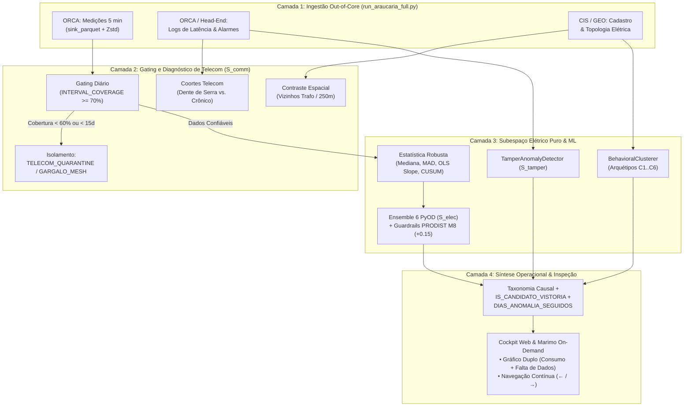

# Arquitetura Multi-Visão para Detecção de Anomalias em Smart Grid: Mapeamento Epistemológico, Engenharia Out-of-Core, Modelos Especializados e Fusão Diagnóstica

---

## Resumo

Este artigo formaliza a arquitetura metodológica e de engenharia de dados do sistema de detecção de anomalias e perdas não-técnicas (PNT) desenvolvido para a infraestrutura de medição inteligente (AMI) da Copel na região de Araucária/PR. Em redes inteligentes com centenas de milhares de medidores transmitindo em alta frequência (intervalos de 5 minutos, totalizando 288 leituras diárias por medidor), dois desafios coexistem: (1) o desafio computacional de ingerir, explodir JSONs de medição e consolidar bilhões de pontos sem estourar a memória RAM; e (2) o desafio analítico, no qual falhas de telecomunicação na malha RF Mesh mimetizam quedas de consumo, enquanto sazonalidades de carga e injeção de microgeração distribuída (GD) geram falsos alarmes de fraude. 

Para resolver ambos os problemas, o projeto evoluiu de scripts exploratórios para um ecossistema completo estruturado na entidade canônica **`UC × cutoff_date`**: uma camada de engenharia *out-of-core* baseada em partições Parquet/Zstd e streaming (`sink_parquet`), orquestrada por uma Interface de Terminal (TUI) e validada por suíte de testes automatizados; e uma arquitetura analítica ortogonal decomposta em quatro domínios de conhecimento (**Estatística Robusta**, **Machine Learning Não-Supervisionado**, **Heurísticas de Engenharia de Sinais** e **Regras Físico-Regulatórias**), culminando no **Cockpit Analítico AMI** e na fila priorizada de **Candidatos a Vistoria**.

---

## 1. Mapeamento de Domínio: O Que É Estatística, ML, Heurística e Regra de Negócio

Um dos principais equívocos em ciência de dados aplicada a sistemas de potência é classificar qualquer fórmula matemática como "Machine Learning" ou reduzir regras regulatórias a simples "heurísticas". A Tabela 1 estabelece a separação ontológica rigorosa de cada ferramenta utilizada no pipeline.

### Tabela 1: Matriz Epistemológica das Ferramentas do Pipeline AMI

| Domínio Metodológico | Natureza do Raciocínio | Ferramentas / Componentes no Código | O que Resolve no Pipeline |
| :--- | :--- | :--- | :--- |
| **Estatística Descritiva e Robusta** | Teoria da probabilidade, inferência não-paramétrica e estimadores de alta tolerância a contaminação (*high breakdown point*). | • Mediana Diária $\tilde{E}$ e Interquartil ($IQR$)<br>• Desvio Absoluto da Mediana ($MAD$)<br>• Escala Robusta ($1{,}4826 \cdot MAD$)<br>• *Modified Z-Score* ($z_{\text{self}}$)<br>• Cercas de Tukey em $\log(1+x)$<br>• Regressão Linear $OLS$ no Tempo ($Slope$)<br>• Algoritmo CUSUM de *Change-Point*<br>• Coeficiente de Variação Robusto ($CV$) | Define a baseline da UC imune à influência dos próprios picos ou quedas anômalas. Mede a dispersão intrínseca do consumidor e detecta quebras estruturais de patamar temporal sem pressupor distribuição gaussiana. |
| **Machine Learning (Não-Supervisionado e Semi-Supervisionado)** | Aprendizado indutivo a partir dos dados, modelagem de geometria em alta dimensão, densidade local relativa e particionamento de hiperespaço. | • *Isolation Forest* (Isolamento recursivo)<br>• *Local Outlier Factor* ($LOF$ - densidade $k$-NN)<br>• $ECOD$ (Caudas empíricas bicaudais)<br>• $COPOD$ (Cópulas multivariadas)<br>• $HBOS$ (Densidade unidimensional rápida)<br>• *Robust PCA* (Erro residual de reconstrução)<br>• *K-Means* + $PCA$ (Arquétipos de Carga $C_1 \dots C_6$)<br>• *Cohort Clustering* (Perfis de Telecom) | Captura anomalias multivariadas sutis onde nenhuma feature isolada viola um limiar óbvio, mas a combinação no hiperespaço (ex.: consumo baixo + desbalanço de corrente + fator de carga atípico) revela fraude ou defeito. |
| **Heurísticas e Engenharia de Sinais** | Aproximações práticas fundamentadas na física do sistema e no comportamento operacional da rede, calibradas empiricamente. | • Gating de Cobertura Diária ($\ge 70\%$ de intervalos)<br>• Quarentena Telecom ($< 60\%$ ou $< 15$ dias confiáveis)<br>• Detecção de Degrau Inter-Cutoffs ($\Delta\% \le -45\%$)<br>• Comitê de Pesos Estáticos do Ensemble Composto<br>• Déficit de Cobertura Espacial vs. Vizinhos no Trafo<br>• Normalização Quantílica Min-Max (p01-p99)<br>• Persistência Temporal (`DIAS_ANOMALIA_SEGUIDOS`) | Isola a telemetria degradada da malha de dados antes de qualquer acusação elétrica; separa ruídos pontuais de 1 dia de anomalias crônicas contínuas e pondera votos de consenso. |
| **Regras de Negócio e Físico-Regulatórias** | Leis da eletricidade (Kirchhoff, conservação de energia), resoluções normativas da ANEEL e contratos comerciais da distribuidora. | • Módulo 8 do PRODIST (Limites de Tensão e Desbalanço)<br>• Resolução Normativa ANEEL 482/2012 e 1.059/2023 (GD)<br>• Física do Bypass de Fase ($I_{\text{imbalance}} > 70\%$ com $U$ nominal)<br>• Metrologia do Medidor Travado ($U > 0$ e $I = 0$ crônico)<br>• Ciclo de Vida Cadastral ($\le 30\text{d}$ UC Nova / Troca de Medidor) | Fornece os *guardrails* determinísticos de segurança física (bônus PRODIST $+0{,}15$), transforma anomalias numéricas em diagnósticos causais acionáveis (PNT, GD, Defeito) e garante conformidade jurídica. |

---

## 2. Descrição Detalhada dos Modelos Especializados e Blindagem de Subespaço

Em vez de submeter todas as variáveis a um único modelo "caixa-preta", o sistema de Araucária decompõe a inferência em **seis modelos especializados ortogonais**, garantindo explicabilidade e auditabilidade regulatória.

### 2.1 Blindagem Estrita de Subespaço (`select_pure_electrical_features`)
Uma falha comum em projetos de Smart Grid é incluir métricas de comunicação (`avg_interval_coverage`, `latency`, `alarm_count`) na mesma matriz $X$ dos algoritmos de fraude elétrica. Quando isso ocorre, o modelo aprende um viés espúrio (*confounding bias*): medidores que perderam pacotes de rádio recebem scores de anomalia elétrica elevados.

Para eliminar esse problema na raiz, a função [`select_pure_electrical_features`](file:///d:/Projects/tcc_extraction/src/models/composite.py#L53-L72) bane explicitamente da matriz de entrada do ML qualquer coluna contendo os tokens:
`("coverage", "reliable_day", "null_ratio", "latency", "alarm", "meter_age", "meter_changed", "n_meters", "peer_median_coverage", "coverage_deficit")`.
Assim, o comitê de ML avalia **estritamente grandezas físicas da carga**.

### 2.2 Modelo de Anomalias de Telecomunicação ($S_{\text{comm}}$ & Padrão Dentro do Padrão)
- **Classe / Módulo:** `CommunicationAnomalyDetector` ([`src/models/specialized_detectors.py`](file:///d:/Projects/tcc_extraction/src/models/specialized_detectors.py#L27)) e Coortes de Latência.
- **Descoberta do Padrão Dente de Serra (Heatmap ORCA):** A análise dos histogramas de atraso revelou um padrão periódico em "dente de serra" (diagonais de 15m a 240m). Esse comportamento **não é anomalia**, mas a assinatura determinística do *polling* em lote da rede RF Mesh. Portanto, classificar um perfil de comunicação não equivale a detectar fraude.
- **Subclassificação da Anomalia dentro do Padrão:** A anomalia real de telecomunicação reside nas classes minoritárias ($< 2\%\text{ a }3\%$) que fogem ao comportamento da sua coorte espacial:
  - *Crônico Estrutural:* atraso médio $> 45$ min com $CV < 1{,}1$.
  - *Intermitente / Estouro de Buffer:* $CV > 1{,}1$ com surtos extremos.
  - *Anomalia Espacial Isolada:* a UC apresenta cobertura $< 60\%$ enquanto os vizinhos do mesmo transformador/raio de 250m mantêm mediana $\ge 80\%$ (`meta__coverage_deficit_vs_peers >= 0.30`) — indício de defeito no transceptor ou blindagem intencional de antena (Gaiola de Faraday).

### 2.3 Modelo de Anomalias Elétricas e Físicas ($S_{\text{elec}}$)
- **Classe / Módulo:** `ElectricalAnomalyDetector` ([`src/models/specialized_detectors.py`](file:///d:/Projects/tcc_extraction/src/models/specialized_detectors.py#L88)).
- **Gating de Qualidade:** Se `data_quality < 0.70`, o detector emite `is_reliable = False` e não gera acusação elétrica.
- **Entradas:** `HIST_FA_SUM_MEDIAN`, `HIST_FA_SUM_MAD`, `FA_CV_WINDOW`, `TREND_FA_SLOPE`, `HIST_LOAD_FACTOR_MEAN`, `HIST_CURRENT_IMBALANCE_MAX`, `HIST_VOLTAGE_IMBALANCE_MAX`, `HIST_RA_REVERSAL_RATIO_MAX`.

### 2.4 Modelo de Intrusão Física e Alertas de Hardware ($S_{\text{tamper}}$)
- **Classe / Módulo:** `TamperAnomalyDetector` ([`src/models/specialized_detectors.py`](file:///d:/Projects/tcc_extraction/src/models/specialized_detectors.py#L153)).
- **Mecanismo:** Pondera alarmes físicos de hardware (abertura de tampa, campo magnético externo, inversão de fase), queda de consumo (`TREND_FA_SLOPE`) e troca recente de medidor (`meter_changed_30d`):
  $$S_{\text{tamper}} = \text{clip}\left(0{,}70 \cdot \frac{\text{Alarmes}}{3} + 0{,}30 \cdot \frac{-\text{Slope}}{5} + 0{,}15 \cdot \text{Troca30d}, \; 0, \; 1\right)$$

### 2.5 Clusterizador Comportamental de Arquétipos de Consumo ($C_1 \dots C_6$)
- **Classe / Módulo:** `BehavioralClusterer` ([`src/models/specialized_detectors.py`](file:///d:/Projects/tcc_extraction/src/models/specialized_detectors.py#L195)) e `assign_behavioral_consumption_classes` ([`src/models/category_reporting.py`](file:///d:/Projects/tcc_extraction/src/models/category_reporting.py#L318)).
- **Mecanismo:** Segmenta os consumidores em 6 macro-classes ($C_1$ Mínimo/Desocupado até $C_5$ Alta Carga Contínua e $C_6$ Prosumidor com injeção reversa) e rastreia transições temporais entre *cutoffs* (`TRAJETORIA_CLASSES_TEMPORAL`), flagrando quedas abruptas ($\Delta\% \le -45\%$) não associadas a troca de medidor.

### 2.6 O Ensemble Multivariado PyOD (`CompositeAnomalyDetector`)
- **Classe / Módulo:** `CompositeAnomalyDetector` ([`src/models/composite.py`](file:///d:/Projects/tcc_extraction/src/models/composite.py#L259-L483)).
- **Fusão de 6 Famílias Matemáticas:** Combina normalização Min-Max ($[0, 1]$) de seis detectores não-supervisionados complementares:
  $$\text{Score}_{\text{Ensemble}} = 0{,}22 \cdot \text{IF} + 0{,}20 \cdot \text{LOF} + 0{,}18 \cdot \text{ECOD} + 0{,}18 \cdot \text{COPOD} + 0{,}10 \cdot \text{HBOS} + 0{,}12 \cdot \text{PCA}$$
- **Guardrails PRODIST Módulo 8:** Adiciona deterministamente $+0{,}15$ ao score final em casos de violação física crítica ($v_{\text{pu}} < 0{,}70$ ou $> 1{,}25$, desequilíbrio de tensão $> 20\%$ ou razão de reversão $> 0{,}85$).
- **Decisão Binária:** `IS_ANOMALY = True` quando o score atinge o percentil `100 * (1 - contamination)` (padrão `0.05`).

### 2.7 Mineração de Evidências, Candidatos a Vistoria e Persistência Temporal
- **Módulos:** `AnomalyEvidenceMiner` ([`src/models/evidence_miner.py`](file:///d:/Projects/tcc_extraction/src/models/evidence_miner.py#L18)), `apply_delimited_isolation_and_categories` ([`src/models/category_reporting.py`](file:///d:/Projects/tcc_extraction/src/models/category_reporting.py#L465)) e [`scripts/enrich_candidate_vistorias.py`](file:///d:/Projects/tcc_extraction/scripts/enrich_candidate_vistorias.py).
- **Categoria `CANDIDATOS_A_VISTORIA` (`IS_CANDIDATO_VISTORIA`):** Consolida apenas as anomalias elétricas/físicas acionáveis para equipes de campo (PNT/Fraude, Bypass, Degrau CUSUM, GD Clandestina, Medidor Travado e Falha Óptica Isolada), removendo gargalos coletivos de rede RF Mesh e UCs em iniciação cadastral ($\le 30$ dias).
- **Métrica `DIAS_ANOMALIA_SEGUIDOS`:** Varre de forma vetorizada as partições diárias (`uc_day_features`) e conta o *streak* máximo de dias consecutivos em que a UC manteve desvio ativo. Isso impede que picos isolados de 1 único dia gerem ordens de serviço indevidas, priorizando fraudes crônicas persistentes.

---

## 3. Arquitetura de Engenharia de Dados, Evolução e Qualidade de Software

Um projeto de Smart Grid em escala real não se sustenta apenas com equações estatísticas; ele exige engenharia de dados robusta para operar em hardware corporativo padrão sem colapsar.

### 3.1 Evolução do Projeto: Do Script Monolítico à Arquitetura Canônica
O projeto passou por três gerações arquiteturais documentadas:
1. **Fase 1 (Extração Monolítica por Alimentador):** Scripts acoplados que liam apenas um alimentador (ex.: *Fonte Nova*), sujeitos a falhas de memória quando escalados para toda a cidade.
2. **Fase 2 (Arquitetura Semântica `UC × cutoff_date`):** Separação estrita entre **Fenômenos** (`ami_interval`, `ami_instantaneous`, `ami_registers`), **Contexto** (`uc_context`, `meter_installation_history`, `electrical_hierarchy`) e **Eventos** (`alarm_events`), evitando *data leakage* temporal entre janelas móveis.
3. **Fase 3 (Produção Multi-Alimentador, Streaming e Cockpit):** Extração paralela de toda a região de Araucária (262.849 janelas avaliadas), enriquecimento espacial, versionamento de modelos (`src/models/registry.py`) e interface interativa para operação.

### 3.2 Extração em Lotes e Normalização *Out-of-Core* com `sink_parquet`
A extração completa via [`scripts/run_araucaria_full.py`](file:///d:/Projects/tcc_extraction/scripts/run_araucaria_full.py) suporta sincronização incremental inteligente (`--auto-backfill`), preenchendo automaticamente lacunas históricas entre a última data consolidada e o dia anterior.

O maior gargalo de memória ocorria na explosão dos JSONs do MDM (onde 1 linha por medidor expande para 288 linhas de 5 minutos por dia). Para evitar `Out-Of-Memory (OOM)`, implementou-se em [`src/datasets/normalize.py`](file:///d:/Projects/tcc_extraction/src/datasets/normalize.py#L675-L762) a função **`normalize_and_sink_mdm_batches`**:
- Lotes brutos são processados em paralelo (`ThreadPoolExecutor(max_workers=5)`) e gravados como fragmentos temporários em disco (`interval_chunk_XXXXX.parquet`).
- Em seguida, o motor Lazy do Polars (`pl.scan_parquet`) encadeia os fragmentos e executa **`lf.sink_parquet(..., compression="zstd")`**, realizando a consolidação final em modo *streaming out-of-core*.
- **Resultado:** O consumo de RAM permanece estritamente limitado ao tamanho de um único lote por *worker*, independentemente do volume total de dias ou medidores.

### 3.3 Interface de Terminal (TUI) e Reprodutibilidade via `uv`
Toda a operação em linha de comando é centralizada na TUI interativa construída com `rich` ([`main.py`](file:///d:/Projects/tcc_extraction/main.py) $\rightarrow$ `src/tui/tui_app.py::RichPipelineTUI`), oferecendo 7 fluxos integrados (Extração, Treinamento Versionado, Estatísticas do Data Lake, Comparação Especialistas vs. Global, Auditoria de Saúde, Configurações e Saída) e proteção contra execução fora do ambiente isolado gerenciado pelo `uv`.

### 3.4 Cultura de Testes Automatizados e Auditoria Contínua
A confiabilidade das regras físicas, do cálculo de features sem *data leakage* e da integridade das partições é verificada continuamente via **`pytest`**:
- Testes unitários e de integração cobrindo normalização de JSONs, esquemas Polars, cálculo de janelas móveis, regras PRODIST e separação de categorias.
- Teste ponta a ponta (**E2E**) em `tests/test_full_pipeline_e2e.py` e rotina de verificação diária em `scripts/daily_automation.py --mode health-check`, gerando relatórios imutáveis de saúde (`output/reports/daily_health_report_latest.md`) e manifestos de execução (`output/runs/run_*.json`).

---

## 4. Arquitetura de Fusão e Complementaridade



---

## 5. Maiores Dificuldades Encontradas e o Desafio de Quantificar Resultados

O desenvolvimento em dados reais da Copel impôs quatro desafios críticos de engenharia e ciência de dados:

1. **Explosão Dimensional e Limite de Memória:** Descompactar centenas de milhares de vetores JSON de 288 pontos diários em Python puro causava exaustão de memória, exigindo a reengenharia completa para processamento em *chunks* e *streaming* via `sink_parquet`.
2. **Assincronia entre Camada Física e Camada de Rede:** A perda intermitente de pacotes RF Mesh e o padrão em dente de serra do *polling* simulavam quedas bruscas de consumo, superlotando os rankings iniciais de anomalia com falsos positivos de telecomunicação até a introdução da blindagem de subespaço e do contraste espacial com vizinhos.
3. **Alinhamento Temporal e *Data Leakage*:** Misturar datas futuras de troca de medidor ou usar médias globais contaminava a avaliação histórica, resolvido pela imposição rígida da matriz `UC × cutoff_date` com janelas estritamente retroativas.
4. **O Desafio Central — Quantificar Resultados sem *Ground Truth* Massivo:**  
   Em ambientes reais de distribuidoras, não existe um dataset rotulado completo indicando quais das 262.849 janelas possuem fraude confirmada em campo (os rótulos só surgem *após* o envio de equipes de inspeção). Consequentemente, métricas supervisionadas tradicionais (*Precision*, *Recall*, *F1-Score* global) não podem ser calculadas de forma ingênua sobre toda a base sem risco de falácia metodológica.  
   **Como o sistema quantifica e comprova consistência hoje:**
   - **Consenso Inter-Modelos:** Exigência de concordância entre 6 paradigmas matemáticos ortogonais (árvores, densidade $k$-NN, caudas empíricas, cópulas, histogramas e subespaço PCA).
   - **Validação por Evidência Física (PRODIST & Desequilíbrio):** Verificação cruzada de violações de leis elétricas simultâneas ao score alto de ML.
   - **Persistência Temporal (`DIAS_ANOMALIA_SEGUIDOS`):** Prova quantitativa de que o desvio não é flutuação estatística momentânea, mas um regime sustentado dia após dia.
   - **Auditabilidade Visual On-Demand:** Capacidade de abrir instantaneamente a série temporal real horária/diária e o diagnóstico de completude telecom para validar fisicamente cada candidato antes da expedição de Ordem de Serviço.

---

## 6. Validação, Limitações, Trabalhos Futuros e Ferramenta Operacional

### 6.1 Limitações Reconhecidas
- **Pesos Estáticos do Ensemble:** Os pesos $(0{,}22; 0{,}20; 0{,}18; 0{,}18; 0{,}10; 0{,}12)$ e o bônus PRODIST ($+0{,}15$) foram calibrados por diversidade arquitetural e conhecimento de domínio, não por otimização bayesiana supervisionada.
- **Ciclo de Feedback de Campo (Trabalhos Futuros):** À medida que as equipes da Copel executarem vistorias guiadas pelo ranking `CANDIDATOS_A_VISTORIA`, o retorno de campo (*Procedente / Improcedente*) permitirá calibrar limiares via aprendizado semi-supervisionado (*Active Learning*) e calcular a taxa de acerto (*Hit Rate / Precision@K*) em produção.

### 6.2 Como Rodar o Cockpit Web e o Notebook On-Demand (Windows CMD)

Todo o ecossistema pode ser executado localmente pelo Prompt de Comando (CMD) sem necessidade de pré-gerar imagens estáticas:

```cmd
:: 1. Enriquecer os candidatos com o cálculo vetorizado de DIAS_ANOMALIA_SEGUIDOS
uv run python scripts/enrich_candidate_vistorias.py

:: 2. Iniciar o Cockpit Web interativo (abre em http://127.0.0.1:8050)
uv run python scripts/run_web_cockpit.py

:: 3. (Opcional) Abrir a TUI completa do pipeline
uv run main.py

:: 4. (Opcional) Abrir o Notebook Marimo com inspeção on-demand por UC
uv run marimo run notebooks/eda_dataset_marimo.py
```

---

## Referências

1. **ZHAO, Y.; NASRULLAH, Z.; LI, Z.** PyOD: A Python Toolbox for Scalable Outlier Detection. *Journal of Machine Learning Research (JMLR)*, v. 20, n. 96, p. 1–7, 2019.
2. **LI, Z. et al.** ECOD: Unsupervised Outlier Detection Using Empirical Cumulative Distribution Functions. *IEEE Transactions on Knowledge and Data Engineering (TKDE)*, 2022.
3. **LI, Z. et al.** COPOD: Copula-Based Outlier Detection. *IEEE International Conference on Data Mining (ICDM)*, 2020.
4. **LIU, F. T.; TING, K. M.; ZHOU, Z.-H.** Isolation Forest. *IEEE International Conference on Data Mining (ICDM)*, p. 413–422, 2008.
5. **BREUNIG, M. M. et al.** LOF: Identifying Density-Based Local Outliers. *ACM SIGMOD Record*, v. 29, n. 2, p. 93–104, 2000.
6. **GOLDSTEIN, M.; DENGEL, A.** Histogram-based Outlier Score (HBOS): A fast Unsupervised Anomaly Detection Algorithm. *KI-2012 Poster and Demo Track*, p. 59–63, 2012.
7. **ANEEL.** *Procedimentos de Distribuição de Energia Elétrica no Sistema Elétrico Nacional — PRODIST, Módulo 8: Qualidade do Fornecimento de Energia Elétrica*. Brasília, 2021.
8. **ANEEL.** *Resolução Normativa nº 1.059/2023* (Aprimoramento das regras de Microgeração e Minigeração Distribuída). Brasília, 2023.
