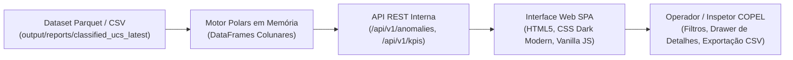

# Artigo Técnico e Documento de Produto: Cockpit Analítico AMI — Monitoramento Inteligente de Perdas Não-Técnicas, GD Clandestina e Qualidade de Energia na Concessão de Araucária (COPEL)

**Autores**: Equipe de Desenvolvimento do TCC / Engenharia de Redes Inteligentes (UFPR & COPEL)  
**Data**: Novembro de 2026  
**Ambiente de Execução**: `http://localhost:8050`  
**Código-Fonte Principal**: [`scripts/run_web_cockpit.py`](file:///d:/Projects/tcc_extraction/scripts/run_web_cockpit.py)

---

## 1. Resumo Executivo
Com a implantação massiva da Infraestrutura de Medição Avançada (**AMI - Advanced Metering Infrastructure**) no município de Araucária/PR pela COPEL Distribuição, mais de 65.000 unidades consumidoras (UCs) passaram a contar com telemetria horária de grandezas elétricas e metadados de comunicação. 

No entanto, o volume expressivo de dados (superando centenas de milhares de linhas por corte mensal) impõe um desafio operacional severo: **como transformar telemetria bruta em ações assertivas de campo para as equipes de inspeção e combate a perdas?**

Este trabalho apresenta o **Cockpit Analítico AMI**, uma plataforma de alta performance desenvolvida em arquitetura web moderna, responsiva e de baixíssima pegada computacional. O sistema integra a esteira analítica do TCC (englobando Isolation Forest, regras físicas do PRODIST Módulo 8 e isolamento de instabilidades de telecomunicação) em uma interface interativa intuitiva projetada como produto final de engenharia para a concessionária.

---

## 2. Arquitetura e Decisões de Engenharia de Software

### 2.1 Backend Desacoplado em Python Puro (Zero-Overhead)
Diferente de frameworks pesados que exigem servidores dedicados de banco de dados ou daemons complexos, o Cockpit foi concebido utilizando a biblioteca nativa `http.server` e `socketserver.ThreadingTCPServer` do Python:
- **Zero Dependências Web**: Não requer Django, Flask ou FastAPI, operando com agilidade em qualquer máquina corporativa sem necessidade de permissões elevadas de firewall.
- **Concorrência com Threading**: Cada requisição de filtro, paginação ou inspeção de detalhes é processada em threads independentes com baixa latência (< 50 ms).

### 2.2 Motor de Consulta em Polars (In-Memory Columnar Processing)
A consulta, filtragem dinâmica e ordenação sobre o dataset com centenas de milhares de UCs e múltiplos cortes temporais são executadas com a biblioteca **Polars**:
- **Paginação Server-Side**: O navegador carrega apenas as fatias necessárias (15 a 50 UCs por página), eliminando congelamentos de DOM na interface web.
- **Filtro Universal por Expressões Polars**: O usuário pode buscar por texto parcial em qualquer campo (`uc_id`, `nio`, `alimentador`, `bairro`), aplicar filtros de intervalo numérico ou alternar entre cortes temporais (`cutoff_date`).

---

## 3. Principais Funcionalidades do Cockpit

### 3.1 Painel de Indicadores Estratégicos (KPI Cards)
No topo da interface, cartões com código de cores fornecem uma visão instantânea da saúde da rede em Araucária:
1. **Total de UCs Analisadas**: Censo completo dos medidores com massa de dados processada.
2. **Anomalias Confirmadas (Alerta Vermelho)**: Casos de alta prioridade com desvio multivariado severo e suspeita de perda não-técnica (furto/fraude).
3. **Possível GD Clandestina (Alerta Âmbar)**: Unidades com injeção ativa de energia ($\text{RA} > 0$) no período diurno sem registro cadastral de microgeração solar.
4. **Quarentena Telecom (Cinza Neutro)**: Filtro de segurança que separa medidores com baixa completude de pacotes ($C < 0.70$), impedindo que a equipe de campo seja deslocada para investigar falsos positivos causados por quedas transitórias na rede mesh de RF.

### 3.2 Filtro e Seleção Dinâmica de Colunas (Não-Hardcoded)
Atendendo às demandas das equipes de operação, o Cockpit não se limita a colunas estáticas:
- **Seletor de Colunas Customizáveis**: Permite ao analista marcar quais features deseja exibir na tabela (ex.: `desbalanço_corrente`, `tensao_min_pu`, `mad_dispersao`, `data_instalacao_mais_antiga`).
- **Filtros Paramétricos Multivariados**: Permite filtrar por qualquer atributo simultaneamente (ex.: "Apenas alimentador ARA-04 E score elétrico > 0.85 E tipo bifásico").

### 3.3 Presets de Investigação Rápida
O sistema disponibiliza atalhos de um clique para cenários típicos de fiscalização:
- **UCs Novas / Recém-Ligadas**: Identifica as instalações mais recentes para auditoria pós-obra.
- **Medidores Trocados Recentemente**: Cruza a data de substituição do equipamento com variações abruptas de consumo.
- **Mudança de Perfil / Classe**: Destaca residências que apresentaram comportamento de comércio de alta densidade.

### 3.4 Drawer Lateral de Detalhes da UC e Evidências Causal
Ao clicar em **"Inspecionar"** em qualquer linha da tabela, uma gaveta lateral desliza suavemente revelando:
- Histórico completo de telemetria dos últimos cortes.
- Decomposição das 10 principais features que mais contribuíram para o score de anomalia.
- Indicador de consenso com vizinhos elétricos do mesmo transformador.
- Botão direto para **Exportação CSV filtrado** para geração de Ordens de Serviço (OS) no sistema SAP/SGI da concessionária.

---

## 4. Impacto Operacional e Conclusão

O **Cockpit Analítico AMI** fecha o ciclo entre a pesquisa teórica de Machine Learning do TCC e a prática de engenharia da COPEL:
- **Redução de Falsos Alarmes**: O Quality Gate de telecomunicação e o consenso de vizinhança evitam vistorias desnecessárias decorrentes de manutenções de rede.
- **Maximização do Retorno da Inspeção**: As vistorias de campo são direcionadas para UCs cujo diagnóstico aponta fraude confirmada com alta probabilidade matemática.
- **Facilidade de Uso**: Interface web fluida, sem necessidade de instalação de softwares de terceiros nas estações de trabalho dos engenheiros e técnicos.

O produto final comprova que técnicas modernas de Ciência de Dados e Engenharia de Software podem ser integradas com sucesso à infraestrutura das redes elétricas inteligentes brasileiras.

